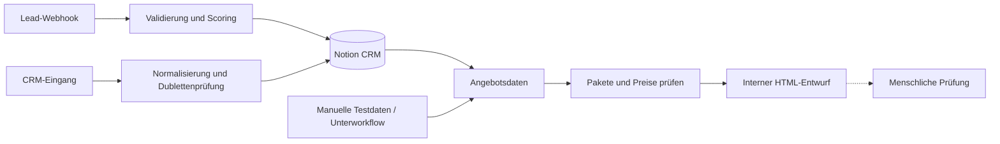

# Lead-to-Offer Automation Suite

Drei zusammengehörige n8n-Workflows für Lead-Eingang, CRM-Verarbeitung und interne Angebotsentwürfe. Schwerpunkt sind nachvollziehbare Datenverarbeitung und getrennte Fehlerpfade.

## Problem & Lösung

Anfragen sollen vollständig erfasst, bewertet und ohne unnötige CRM-Dubletten bearbeitet werden. Die Workflows validieren Eingaben, arbeiten mit einem gemeinsamen Notion-Datenmodell und bereiten Angebote zur manuellen Prüfung vor. Die Exporte besitzen eigene Einstiegspunkte; sie sind kein bereits fertig verbundener Ein-Klick-Workflow.

## Exporte & Tech-Stack

| Workflow | Einstieg | Export |
| --- | --- | --- |
| Lead Intake · 19 Knoten | Website-Webhook | [Lead Intake](../../lead-intake-system.sanitized.json) |
| CRM · 15 Knoten | Manueller Test oder Unterworkflow-Eingang | [CRM](../../crm-system.sanitized.json) |
| Offer Generator · 15 Knoten | Manueller Test, Unterworkflow-Eingang oder Zeitplan | [Offer Generator](../../offer-generator.sanitized.json) |

**Stack:** n8n · JavaScript · Webhooks · REST APIs · Notion CRM. Die Exporte enthalten zusätzlich konfigurierbare Benachrichtigungs- und optionale Erweiterungsknoten.

## Workflow-Logik



Die Angebotssumme enthält die einmaligen Projektpakete; monatliche Betreuung wird separat ausgewiesen. Preise müssen JSON-Zahlen mit höchstens zwei Nachkommastellen sein. Ungültige Werte, unbekannte oder doppelte Pakete verhindern einen freigabefähigen Entwurf. Der Angebots-Export versendet keine Kunden-E-Mail.

## Lokal prüfen

Voraussetzung für die automatisierten Prüfungen: Node.js ab Version 20. Im Stammordner dieses Repositories ausführen:

```sh
node --test test/portfolio-site.test.mjs
```

Die Suite enthält 15 Regressionstests für Lead-Validierung und Angebotsdaten sowie die Portfolio-Prüfungen. Sie führt den tatsächlich exportierten JavaScript-Code mit synthetischen Eingaben aus. Dazu gehören Pflichtfelder, E-Mail-Normalisierung, Zustimmung, Spam-Feld, gültige Summen, ungültige Preise und doppelte Pakete. Die Tests führen keine Notion-, E-Mail- oder Telegram-Aufrufe aus.

## In n8n nachvollziehen

1. Die drei Exporte in eine separate Testinstanz importieren; sie sind inaktiv und enthalten keine Credentials.
2. Die eingebetteten Einrichtungsnotizen lesen und die benötigten Notion-Property-Namen sowie die Platzhalter-Datenbank-ID prüfen.
3. Für einen Integrationstest eine eigene Testdatenbank und passende Credentials zuordnen. Benachrichtigungen zunächst deaktivieren oder auf ausdrücklich vorgesehene Testkanäle begrenzen.
4. Mit den enthaltenen manuellen Testdaten oder eigenen synthetischen Eingaben beginnen und die Ausführungsdaten prüfen.

Ein vollständiger Durchlauf mit deinen externen Diensten ist damit noch nicht nachgewiesen. Die lokale Suite prüft Code und Exportstruktur; ein produktiver Betrieb benötigt zusätzlich unter anderem persistente Dublettenabsicherung, Authentifizierung, Rate-Limits und eine dokumentierte Retry-Strategie.

[Visuelle Fallstudie](https://nico89x.github.io/nico-joschke-automation-portfolio/#lead-to-offer) · [Zurück zum Portfolio](../../README.md)
